<a id="top"></a>

<picture>
  <source media="(prefers-color-scheme: dark)" srcset="assets/hero-dark.svg">
  <source media="(prefers-color-scheme: light)" srcset="assets/hero-light.svg">
  
</picture>

<div align="center">

<sub>A showcase of what vanilla Markdown + Mermaid can do: no CSS, no plugins, no JavaScript.<br>The banner above swaps between light and dark versions to match your theme.</sub>

<br>


<br>

**Part I** · [Typography](#-typography) · [Callouts](#-callouts) · [Color](#-color-without-css) · [Data](#-tables--tasks) · [Diagrams](#-mermaid-diagrams) · [Math](#-math)

**Part II** · [Motion](#-motion) · [Flowing diagrams](#-diagrams-that-flow) · [Maps](#-interactive-map) · [3D](#-3d-model) · [Click-to-reveal](#-click-to-reveal) · [Live data](#-live-data)

</div>

---

## ✦ Typography

**Bold**, *italic*, ***both***, ~~strikethrough~~, <ins>underline</ins>, `inline code`, and <kbd>Ctrl</kbd> + <kbd>Shift</kbd> + <kbd>P</kbd>.

H<sub>2</sub>O · E = mc<sup>2</sup> · Footnotes too[^1].

> Nested quotes build hierarchy:
>> *"Simplicity is prerequisite for reliability."*
>>> — Edsger W. Dijkstra

[^1]: Footnotes render at the bottom of the page with back-links.

---

## ✦ Callouts

> [!NOTE]
> Highlights information readers should notice, even when skimming.

> [!TIP]
> Optional advice that helps people do things better.

> [!IMPORTANT]
> Key information required to succeed.

> [!WARNING]
> Urgent information that needs immediate attention.

> [!CAUTION]
> Warns about risks or negative outcomes.

---

## ✦ Color Without CSS

GitHub strips `style` attributes, but **LaTeX math** carries color through:

| Swatch | Token | Usage |
|:------:|:------|:------|
| $\color{#818cf8}\blacksquare\blacksquare\blacksquare$ | `indigo-400` | Primary actions |
| $\color{#f472b6}\blacksquare\blacksquare\blacksquare$ | `pink-400` | Accents & highlights |
| $\color{#4ade80}\blacksquare\blacksquare\blacksquare$ | `green-400` | Success states |
| $\color{#fb923c}\blacksquare\blacksquare\blacksquare$ | `orange-400` | Warnings |
| $\color{#60a5fa}\blacksquare\blacksquare\blacksquare$ | `blue-400` | Data & info |

Build status: $\color{#4ade80}\textsf{● passing}$ · Coverage: $\color{#fb923c}\textsf{● 78\%}$ · Deploy: $\color{#f87171}\textsf{● blocked}$

**Diff blocks** color code by line:

```diff
  server:
-   port: 8080
+   port: 443
+   tls: true
!   timeout: 30s   # review this
#   comments stay neutral
```

---

## ✦ Tables & Tasks

| Feature | Left | Center | Right |
|:--------|:-----|:------:|------:|
| Alignment | ← | ↔ | → |
| Inline code | `GET` | `POST` | `DELETE` |
| Emphasis | **bold** | *italic* | ~~gone~~ |

**Roadmap**

- [x] Design system tokens
- [x] Authentication flow
- [ ] Real-time sync
  - [x] WebSocket gateway
  - [ ] Conflict resolution
- [ ] Public launch 🚀

<details>
<summary><b>▸ Click to expand: collapsible sections</b></summary>

<br>

Hidden content supports **full Markdown**, including code:

```kotlin
data class Showcase(val name: String, val wow: Int = 11)

fun main() = println(Showcase("Markdown"))
```

</details>

---

## ✦ Mermaid Diagrams

### Themed flowchart
Custom node shapes, class-based colors, styled individual edges, and a dashed subgraph.

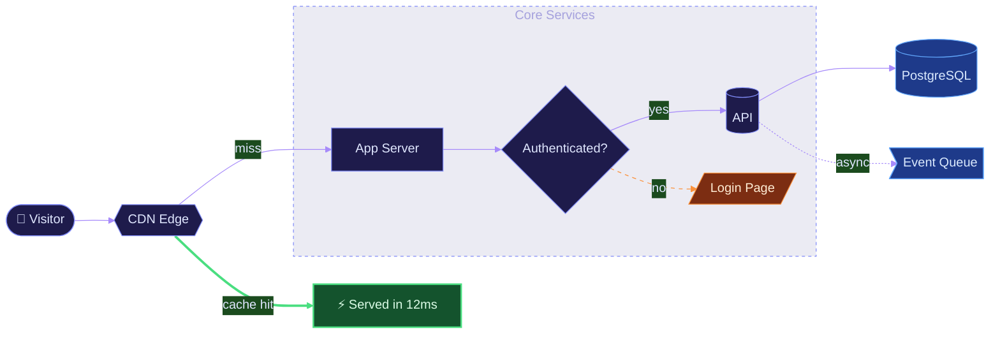

### Animated pipeline
Edges can move. *(Requires Mermaid 11.3+.)*


### Sequence with highlighted regions
Auto-numbered steps, activation bars, tinted blocks, and branching.

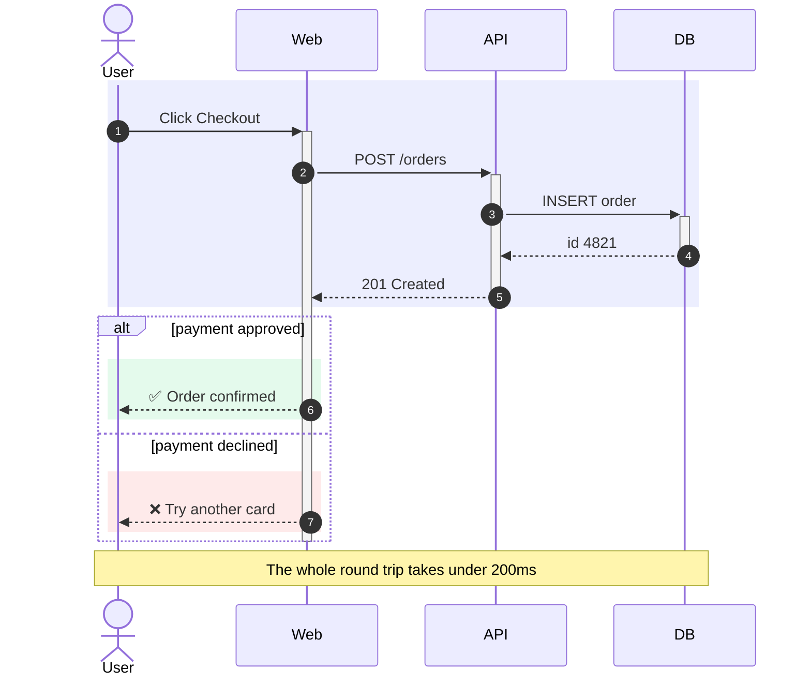

### State machine

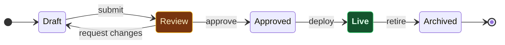

### Gantt timeline
Done, active, critical-path, and milestone states.

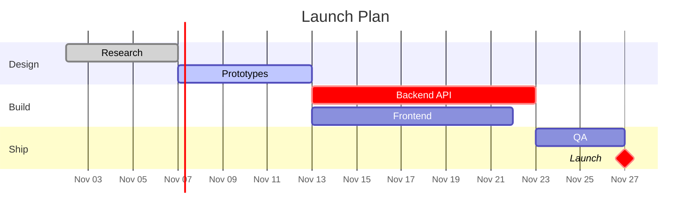

### Custom-palette pie

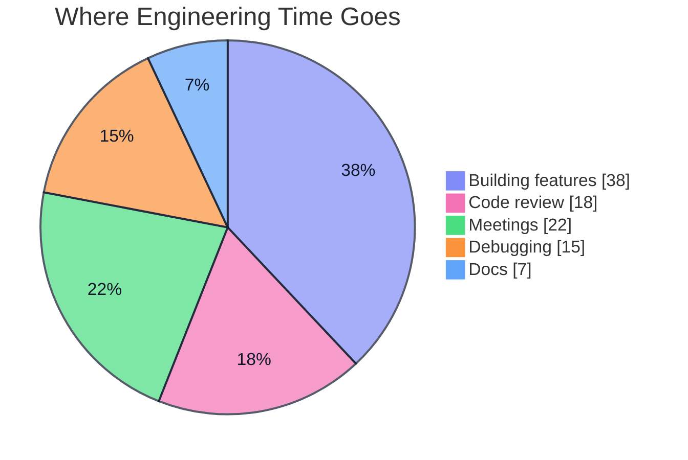

### Git history

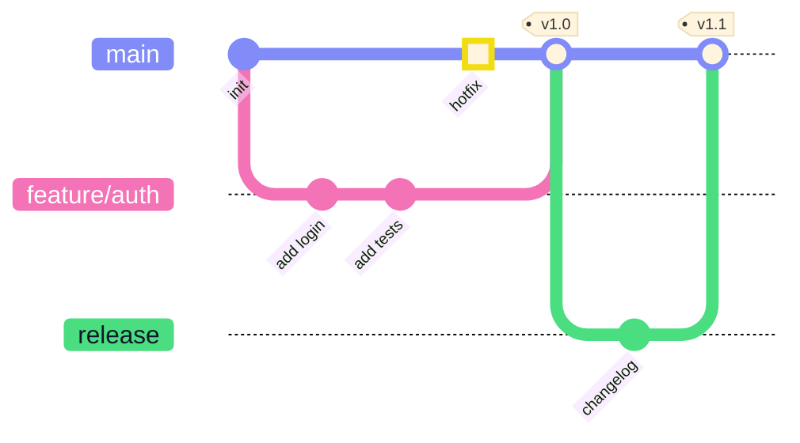

### Priority quadrant

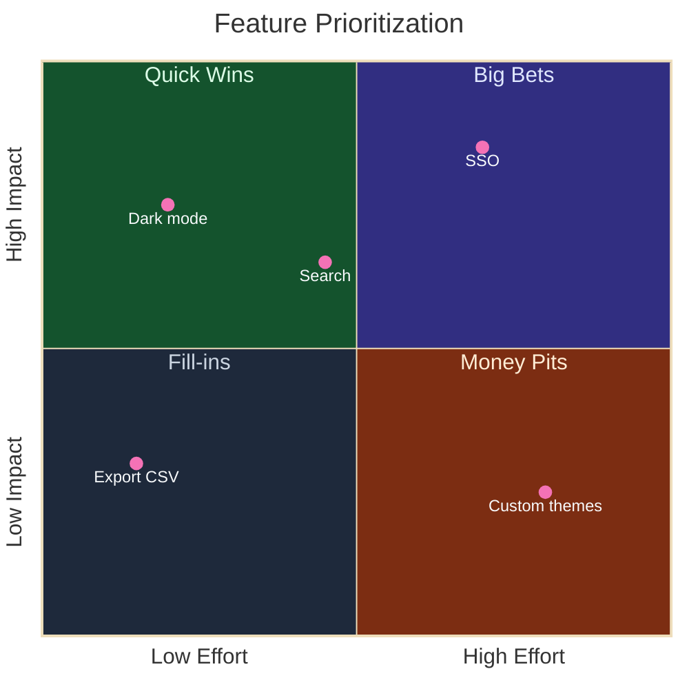

### Bar + line chart

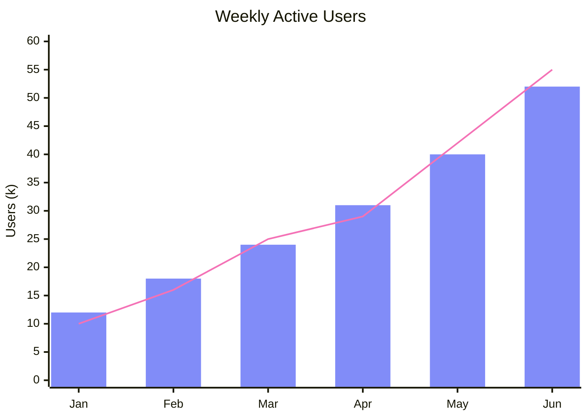

### Mind map

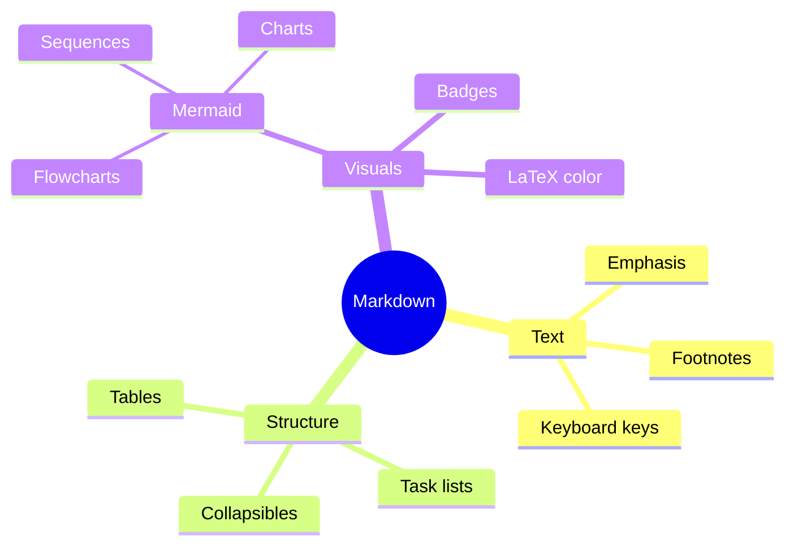

### Timeline

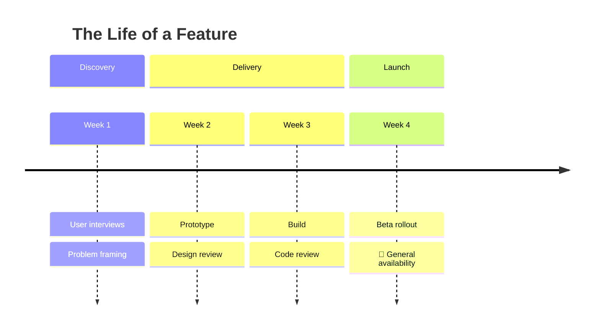

---

## ✦ Math

Inline: the area of a circle is $A = \pi r^2$.

Block, with per-term color:

```math
\color{#f472b6}{a^2} \color{#94a3b8}{\;+\;} \color{#60a5fa}{b^2} \color{#94a3b8}{\;=\;} \color{#4ade80}{c^2}
```

```math
\left( \sum_{k=1}^{n} \color{#818cf8}{a_k} \color{#94a3b8}{b_k} \right)^{2} \leq \left( \sum_{k=1}^{n} \color{#818cf8}{a_k^2} \right) \left( \sum_{k=1}^{n} \color{#94a3b8}{b_k^2} \right)
```

---

<br>

<div align="center">

# Part II · Motion & Interaction

<sub>Everything below moves, responds to clicks, or pulls live data. Still no JavaScript.</sub>

</div>

---

## ✦ Motion

Animated SVGs keep running when embedded as plain images. Each component below is a hand-written `.svg` file in `assets/`, animated with CSS `@keyframes` and SVG `<animate>`, and embedded with ordinary Markdown image syntax.

[](#-motion "Pulsing rings use CSS transform + opacity keyframes")

[](#-motion "The line draws itself with pathLength=1 and stroke-dashoffset")

[](#-motion "Bars fill with scaleX, then a clipped gradient sweeps across them")

[](#-motion "Labels orbit with rotate() while a counter-rotation keeps them upright")

> [!TIP]
> Hover any graphic above for a tooltip explaining how it's animated. Each image is wrapped in a link whose title becomes the tooltip.

<details>
<summary><b>▸ How the animations work</b></summary>

<br>

| Effect | Technique |
|:--|:--|
| Typing banner | SMIL `<animate calcMode="discrete">` steps a clip-path's width one character at a time; the cursor's `x` follows the same timeline |
| Flowing title gradient | `<animateTransform>` slides a repeating `linearGradient` |
| Drifting glow | Blurred circles translated with CSS keyframes |
| Pulse rings | `transform: scale()` + `opacity` with `transform-box: fill-box` |
| Self-drawing line | `pathLength="1"`, then `stroke-dashoffset` animates 1 → 0 |
| Shimmer | A gradient rect slides across, clipped to the bar shapes |
| Upright orbit labels | Outer group rotates, inner group counter-rotates at the same speed |
| Light/dark banner | `<picture>` with `prefers-color-scheme` sources |

```svg
<!-- The core trick behind the self-drawing chart -->
<path d="M70,240 C120,230 ..." pathLength="1"
      style="stroke-dasharray:1; stroke-dashoffset:1;
             animation: draw 9s ease infinite"/>
<style>@keyframes draw { 30% { stroke-dashoffset: 0 } }</style>
```

</details>

<sub>[↑ back to top](#top)</sub>

---

## ✦ Diagrams That Flow

Beyond the built-in `fast`/`slow` presets, a `classDef` can give each edge its own color, dash pattern, speed, and direction. Here, hot paths pulse quickly, async paths drift, and the replication edge runs in reverse. *(Requires Mermaid 11.3+.)*

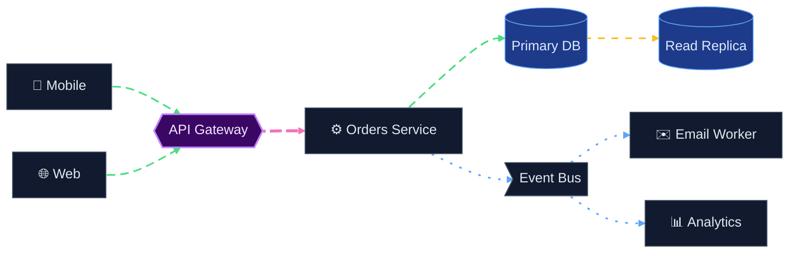

> [!NOTE]
> On GitHub, every Mermaid diagram also gets pan and zoom controls, and an expand button that opens it full screen.

<sub>[↑ back to top](#top)</sub>

---

## ✦ Interactive Map

A ` ```geojson ` block renders as a live map. Drag to pan, scroll to zoom, and **click any marker, route, or area** to see its properties.

```geojson
{
  "type": "FeatureCollection",
  "features": [
    {
      "type": "Feature",
      "properties": { "name": "Texas Coast Road Trip", "distance": "~650 mi", "stroke": "#f472b6", "stroke-width": 4 },
      "geometry": {
        "type": "LineString",
        "coordinates": [
          [-97.7431, 30.2672], [-96.3698, 30.0], [-95.3698, 29.7604], [-94.7977, 29.3013],
          [-95.95, 28.65], [-97.3964, 27.8006], [-97.40, 27.00], [-97.1681, 26.1118]
        ]
      }
    },
    {
      "type": "Feature",
      "properties": { "name": "Austin", "stop": 1, "highlight": "Live music & Barton Springs", "marker-color": "#818cf8", "marker-symbol": "music" },
      "geometry": { "type": "Point", "coordinates": [-97.7431, 30.2672] }
    },
    {
      "type": "Feature",
      "properties": { "name": "Houston", "stop": 2, "highlight": "Space Center Houston", "marker-color": "#818cf8", "marker-symbol": "rocket" },
      "geometry": { "type": "Point", "coordinates": [-95.3698, 29.7604] }
    },
    {
      "type": "Feature",
      "properties": { "name": "Galveston", "stop": 3, "highlight": "Seawall & historic Strand", "marker-color": "#818cf8", "marker-symbol": "beach" },
      "geometry": { "type": "Point", "coordinates": [-94.7977, 29.3013] }
    },
    {
      "type": "Feature",
      "properties": { "name": "Corpus Christi", "stop": 4, "highlight": "USS Lexington museum", "marker-color": "#818cf8", "marker-symbol": "harbor" },
      "geometry": { "type": "Point", "coordinates": [-97.3964, 27.8006] }
    },
    {
      "type": "Feature",
      "properties": { "name": "South Padre Island", "stop": 5, "highlight": "Finish line: sea turtles & sunsets", "marker-color": "#4ade80", "marker-symbol": "star" },
      "geometry": { "type": "Point", "coordinates": [-97.1681, 26.1118] }
    },
    {
      "type": "Feature",
      "properties": { "name": "Padre Island National Seashore", "note": "Longest undeveloped barrier island in the world", "fill": "#4ade80", "fill-opacity": 0.25, "stroke": "#4ade80" },
      "geometry": {
        "type": "Polygon",
        "coordinates": [[
          [-97.36, 27.48], [-97.22, 27.48], [-97.30, 26.90], [-97.42, 26.90], [-97.36, 27.48]
        ]]
      }
    }
  ]
}
```

<sub>[↑ back to top](#top)</sub>

---

## ✦ 3D Model

An ` ```stl ` block renders an interactive 3D viewer. **Drag to rotate, scroll to zoom.** This twisted star vase was generated by a short Python script: 264 triangles of plain text.

```stl
solid twisted_star_vase
facet normal 0.44 0.83 -0.34
outer loop
vertex 20 0 0
vertex 9.53 5.5 0
vertex 9.06 8.16 6
endloop
endfacet
facet normal 0.21 0.75 -0.63
outer loop
vertex 20 0 0
vertex 9.06 8.16 6
vertex 21.68 4.61 6
endloop
endfacet
facet normal 0.88 -0.04 0.48
outer loop
vertex 9.53 5.5 0
vertex 10 17.32 0
vertex 6.85 21.08 6
endloop
endfacet
facet normal 0.99 0.17 0
outer loop
vertex 9.53 5.5 0
vertex 6.85 21.08 6
vertex 9.06 8.16 6
endloop
endfacet
facet normal -0.5 0.8 -0.34
outer loop
vertex 10 17.32 0
vertex 0 11 0
vertex -2.53 11.92 6
endloop
endfacet
facet normal -0.54 0.55 -0.63
outer loop
vertex 10 17.32 0
vertex -2.53 11.92 6
vertex 6.85 21.08 6
endloop
endfacet
facet normal 0.47 0.74 0.48
outer loop
vertex 0 11 0
vertex -10 17.32 0
vertex -14.83 16.47 6
endloop
endfacet
facet normal 0.35 0.94 0
outer loop
vertex 0 11 0
vertex -14.83 16.47 6
vertex -2.53 11.92 6
endloop
endfacet
facet normal -0.94 -0.04 -0.34
outer loop
vertex -10 17.32 0
vertex -9.53 5.5 0
vertex -11.59 3.77 6
endloop
endfacet
facet normal -0.75 -0.19 -0.63
outer loop
vertex -10 17.32 0
vertex -11.59 3.77 6
vertex -14.83 16.47 6
endloop
endfacet
facet normal -0.41 0.78 0.48
outer loop
vertex -9.53 5.5 0
vertex -20 0 0
vertex -21.68 -4.61 6
endloop
endfacet
facet normal -0.64 0.77 0
outer loop
vertex -9.53 5.5 0
vertex -21.68 -4.61 6
vertex -11.59 3.77 6
endloop
endfacet
facet normal -0.44 -0.83 -0.34
outer loop
vertex -20 0 0
vertex -9.53 -5.5 0
vertex -9.06 -8.16 6
endloop
endfacet
facet normal -0.21 -0.75 -0.63
outer loop
vertex -20 0 0
vertex -9.06 -8.16 6
vertex -21.68 -4.61 6
endloop
endfacet
facet normal -0.88 0.04 0.48
outer loop
vertex -9.53 -5.5 0
vertex -10 -17.32 0
vertex -6.85 -21.08 6
endloop
endfacet
facet normal -0.99 -0.17 0
outer loop
vertex -9.53 -5.5 0
vertex -6.85 -21.08 6
vertex -9.06 -8.16 6
endloop
endfacet
facet normal 0.5 -0.8 -0.34
outer loop
vertex -10 -17.32 0
vertex 0 -11 0
vertex 2.53 -11.92 6
endloop
endfacet
facet normal 0.54 -0.55 -0.63
outer loop
vertex -10 -17.32 0
vertex 2.53 -11.92 6
vertex -6.85 -21.08 6
endloop
endfacet
facet normal -0.47 -0.74 0.48
outer loop
vertex 0 -11 0
vertex 10 -17.32 0
vertex 14.83 -16.47 6
endloop
endfacet
facet normal -0.35 -0.94 0
outer loop
vertex 0 -11 0
vertex 14.83 -16.47 6
vertex 2.53 -11.92 6
endloop
endfacet
facet normal 0.94 0.04 -0.34
outer loop
vertex 10 -17.32 0
vertex 9.53 -5.5 0
vertex 11.59 -3.77 6
endloop
endfacet
facet normal 0.75 0.19 -0.63
outer loop
vertex 10 -17.32 0
vertex 11.59 -3.77 6
vertex 14.83 -16.47 6
endloop
endfacet
facet normal 0.41 -0.78 0.48
outer loop
vertex 9.53 -5.5 0
vertex 20 0 0
vertex 21.68 4.61 6
endloop
endfacet
facet normal 0.64 -0.77 0
outer loop
vertex 9.53 -5.5 0
vertex 21.68 4.61 6
vertex 11.59 -3.77 6
endloop
endfacet
facet normal 0.26 0.91 -0.34
outer loop
vertex 21.68 4.61 6
vertex 9.06 8.16 6
vertex 7.8 10.73 12
endloop
endfacet
facet normal 0.05 0.75 -0.66
outer loop
vertex 21.68 4.61 6
vertex 7.8 10.73 12
vertex 22.03 9.81 12
endloop
endfacet
facet normal 0.83 0.14 0.53
outer loop
vertex 9.06 8.16 6
vertex 6.85 21.08 6
vertex 2.52 23.98 12
endloop
endfacet
facet normal 0.93 0.37 0.04
outer loop
vertex 9.06 8.16 6
vertex 2.52 23.98 12
vertex 7.8 10.73 12
endloop
endfacet
facet normal -0.66 0.67 -0.34
outer loop
vertex 6.85 21.08 6
vertex -2.53 11.92 6
vertex -5.39 12.12 12
endloop
endfacet
facet normal -0.63 0.42 -0.66
outer loop
vertex 6.85 21.08 6
vertex -5.39 12.12 12
vertex 2.52 23.98 12
endloop
endfacet
facet normal 0.29 0.79 0.53
outer loop
vertex -2.53 11.92 6
vertex -14.83 16.47 6
vertex -19.51 14.17 12
endloop
endfacet
facet normal 0.14 0.99 0.04
outer loop
vertex -2.53 11.92 6
vertex -19.51 14.17 12
vertex -5.39 12.12 12
endloop
endfacet
facet normal -0.91 -0.23 -0.34
outer loop
vertex -14.83 16.47 6
vertex -11.59 3.77 6
vertex -13.19 1.39 12
endloop
endfacet
facet normal -0.68 -0.33 -0.66
outer loop
vertex -14.83 16.47 6
vertex -13.19 1.39 12
vertex -19.51 14.17 12
endloop
endfacet
facet normal -0.54 0.65 0.53
outer loop
vertex -11.59 3.77 6
vertex -21.68 -4.61 6
vertex -22.03 -9.81 12
endloop
endfacet
facet normal -0.78 0.62 0.04
outer loop
vertex -11.59 3.77 6
vertex -22.03 -9.81 12
vertex -13.19 1.39 12
endloop
endfacet
facet normal -0.26 -0.91 -0.34
outer loop
vertex -21.68 -4.61 6
vertex -9.06 -8.16 6
vertex -7.8 -10.73 12
endloop
endfacet
facet normal -0.05 -0.75 -0.66
outer loop
vertex -21.68 -4.61 6
vertex -7.8 -10.73 12
vertex -22.03 -9.81 12
endloop
endfacet
facet normal -0.83 -0.14 0.53
outer loop
vertex -9.06 -8.16 6
vertex -6.85 -21.08 6
vertex -2.52 -23.98 12
endloop
endfacet
facet normal -0.93 -0.37 0.04
outer loop
vertex -9.06 -8.16 6
vertex -2.52 -23.98 12
vertex -7.8 -10.73 12
endloop
endfacet
facet normal 0.66 -0.67 -0.34
outer loop
vertex -6.85 -21.08 6
vertex 2.53 -11.92 6
vertex 5.39 -12.12 12
endloop
endfacet
facet normal 0.63 -0.42 -0.66
outer loop
vertex -6.85 -21.08 6
vertex 5.39 -12.12 12
vertex -2.52 -23.98 12
endloop
endfacet
facet normal -0.29 -0.79 0.53
outer loop
vertex 2.53 -11.92 6
vertex 14.83 -16.47 6
vertex 19.51 -14.17 12
endloop
endfacet
facet normal -0.14 -0.99 0.04
outer loop
vertex 2.53 -11.92 6
vertex 19.51 -14.17 12
vertex 5.39 -12.12 12
endloop
endfacet
facet normal 0.91 0.23 -0.34
outer loop
vertex 14.83 -16.47 6
vertex 11.59 -3.77 6
vertex 13.19 -1.39 12
endloop
endfacet
facet normal 0.68 0.33 -0.66
outer loop
vertex 14.83 -16.47 6
vertex 13.19 -1.39 12
vertex 19.51 -14.17 12
endloop
endfacet
facet normal 0.54 -0.65 0.53
outer loop
vertex 11.59 -3.77 6
vertex 21.68 4.61 6
vertex 22.03 9.81 12
endloop
endfacet
facet normal 0.78 -0.62 0.04
outer loop
vertex 11.59 -3.77 6
vertex 22.03 9.81 12
vertex 13.19 -1.39 12
endloop
endfacet
facet normal 0.06 0.95 -0.32
outer loop
vertex 22.03 9.81 12
vertex 7.8 10.73 12
vertex 5.74 12.89 18
endloop
endfacet
facet normal -0.11 0.74 -0.67
outer loop
vertex 22.03 9.81 12
vertex 5.74 12.89 18
vertex 20.76 15.08 18
endloop
endfacet
facet normal 0.76 0.3 0.58
outer loop
vertex 7.8 10.73 12
vertex 2.52 23.98 12
vertex -2.68 25.52 18
endloop
endfacet
facet normal 0.83 0.55 0.08
outer loop
vertex 7.8 10.73 12
vertex -2.68 25.52 18
vertex 5.74 12.89 18
endloop
endfacet
facet normal -0.79 0.53 -0.32
outer loop
vertex 2.52 23.98 12
vertex -5.39 12.12 12
vertex -8.3 11.42 18
endloop
endfacet
facet normal -0.69 0.27 -0.67
outer loop
vertex 2.52 23.98 12
vertex -8.3 11.42 18
vertex -2.68 25.52 18
endloop
endfacet
facet normal 0.12 0.81 0.58
outer loop
vertex -5.39 12.12 12
vertex -19.51 14.17 12
vertex -23.44 10.44 18
endloop
endfacet
facet normal -0.06 0.99 0.08
outer loop
vertex -5.39 12.12 12
vertex -23.44 10.44 18
vertex -8.3 11.42 18
endloop
endfacet
facet normal -0.85 -0.42 -0.32
outer loop
vertex -19.51 14.17 12
vertex -13.19 1.39 12
vertex -14.04 -1.48 18
endloop
endfacet
facet normal -0.58 -0.46 -0.67
outer loop
vertex -19.51 14.17 12
vertex -14.04 -1.48 18
vertex -23.44 10.44 18
endloop
endfacet
facet normal -0.64 0.51 0.58
outer loop
vertex -13.19 1.39 12
vertex -22.03 -9.81 12
vertex -20.76 -15.08 18
endloop
endfacet
facet normal -0.89 0.44 0.08
outer loop
vertex -13.19 1.39 12
vertex -20.76 -15.08 18
vertex -14.04 -1.48 18
endloop
endfacet
facet normal -0.06 -0.95 -0.32
outer loop
vertex -22.03 -9.81 12
vertex -7.8 -10.73 12
vertex -5.74 -12.89 18
endloop
endfacet
facet normal 0.11 -0.74 -0.67
outer loop
vertex -22.03 -9.81 12
vertex -5.74 -12.89 18
vertex -20.76 -15.08 18
endloop
endfacet
facet normal -0.76 -0.3 0.58
outer loop
vertex -7.8 -10.73 12
vertex -2.52 -23.98 12
vertex 2.68 -25.52 18
endloop
endfacet
facet normal -0.83 -0.55 0.08
outer loop
vertex -7.8 -10.73 12
vertex 2.68 -25.52 18
vertex -5.74 -12.89 18
endloop
endfacet
facet normal 0.79 -0.53 -0.32
outer loop
vertex -2.52 -23.98 12
vertex 5.39 -12.12 12
vertex 8.3 -11.42 18
endloop
endfacet
facet normal 0.69 -0.27 -0.67
outer loop
vertex -2.52 -23.98 12
vertex 8.3 -11.42 18
vertex 2.68 -25.52 18
endloop
endfacet
facet normal -0.12 -0.81 0.58
outer loop
vertex 5.39 -12.12 12
vertex 19.51 -14.17 12
vertex 23.44 -10.44 18
endloop
endfacet
facet normal 0.06 -0.99 0.08
outer loop
vertex 5.39 -12.12 12
vertex 23.44 -10.44 18
vertex 8.3 -11.42 18
endloop
endfacet
facet normal 0.85 0.42 -0.32
outer loop
vertex 19.51 -14.17 12
vertex 13.19 -1.39 12
vertex 14.04 1.48 18
endloop
endfacet
facet normal 0.58 0.46 -0.67
outer loop
vertex 19.51 -14.17 12
vertex 14.04 1.48 18
vertex 23.44 -10.44 18
endloop
endfacet
facet normal 0.64 -0.51 0.58
outer loop
vertex 13.19 -1.39 12
vertex 22.03 9.81 12
vertex 20.76 15.08 18
endloop
endfacet
facet normal 0.89 -0.44 0.08
outer loop
vertex 13.19 -1.39 12
vertex 20.76 15.08 18
vertex 14.04 1.48 18
endloop
endfacet
facet normal -0.14 0.95 -0.29
outer loop
vertex 20.76 15.08 18
vertex 5.74 12.89 18
vertex 3.05 14.34 24
endloop
endfacet
facet normal -0.26 0.69 -0.67
outer loop
vertex 20.76 15.08 18
vertex 3.05 14.34 24
vertex 17.84 19.81 24
endloop
endfacet
facet normal 0.65 0.44 0.62
outer loop
vertex 5.74 12.89 18
vertex -2.68 25.52 18
vertex -8.24 25.35 24
endloop
endfacet
facet normal 0.69 0.71 0.14
outer loop
vertex 5.74 12.89 18
vertex -8.24 25.35 24
vertex 3.05 14.34 24
endloop
endfacet
facet normal -0.89 0.35 -0.29
outer loop
vertex -2.68 25.52 18
vertex -8.3 11.42 18
vertex -10.9 9.81 24
endloop
endfacet
facet normal -0.73 0.12 -0.67
outer loop
vertex -2.68 25.52 18
vertex -10.9 9.81 24
vertex -8.24 25.35 24
endloop
endfacet
facet normal -0.05 0.78 0.62
outer loop
vertex -8.3 11.42 18
vertex -23.44 10.44 18
vertex -26.07 5.54 24
endloop
endfacet
facet normal -0.27 0.95 0.14
outer loop
vertex -8.3 11.42 18
vertex -26.07 5.54 24
vertex -10.9 9.81 24
endloop
endfacet
facet normal -0.75 -0.59 -0.29
outer loop
vertex -23.44 10.44 18
vertex -14.04 -1.48 18
vertex -13.94 -4.53 24
endloop
endfacet
facet normal -0.47 -0.57 -0.67
outer loop
vertex -23.44 10.44 18
vertex -13.94 -4.53 24
vertex -26.07 5.54 24
endloop
endfacet
facet normal -0.7 0.35 0.62
outer loop
vertex -14.04 -1.48 18
vertex -20.76 -15.08 18
vertex -17.84 -19.81 24
endloop
endfacet
facet normal -0.96 0.24 0.14
outer loop
vertex -14.04 -1.48 18
vertex -17.84 -19.81 24
vertex -13.94 -4.53 24
endloop
endfacet
facet normal 0.14 -0.95 -0.29
outer loop
vertex -20.76 -15.08 18
vertex -5.74 -12.89 18
vertex -3.05 -14.34 24
endloop
endfacet
facet normal 0.26 -0.69 -0.67
outer loop
vertex -20.76 -15.08 18
vertex -3.05 -14.34 24
vertex -17.84 -19.81 24
endloop
endfacet
facet normal -0.65 -0.44 0.62
outer loop
vertex -5.74 -12.89 18
vertex 2.68 -25.52 18
vertex 8.24 -25.35 24
endloop
endfacet
facet normal -0.69 -0.71 0.14
outer loop
vertex -5.74 -12.89 18
vertex 8.24 -25.35 24
vertex -3.05 -14.34 24
endloop
endfacet
facet normal 0.89 -0.35 -0.29
outer loop
vertex 2.68 -25.52 18
vertex 8.3 -11.42 18
vertex 10.9 -9.81 24
endloop
endfacet
facet normal 0.73 -0.12 -0.67
outer loop
vertex 2.68 -25.52 18
vertex 10.9 -9.81 24
vertex 8.24 -25.35 24
endloop
endfacet
facet normal 0.05 -0.78 0.62
outer loop
vertex 8.3 -11.42 18
vertex 23.44 -10.44 18
vertex 26.07 -5.54 24
endloop
endfacet
facet normal 0.27 -0.95 0.14
outer loop
vertex 8.3 -11.42 18
vertex 26.07 -5.54 24
vertex 10.9 -9.81 24
endloop
endfacet
facet normal 0.75 0.59 -0.29
outer loop
vertex 23.44 -10.44 18
vertex 14.04 1.48 18
vertex 13.94 4.53 24
endloop
endfacet
facet normal 0.47 0.57 -0.67
outer loop
vertex 23.44 -10.44 18
vertex 13.94 4.53 24
vertex 26.07 -5.54 24
endloop
endfacet
facet normal 0.7 -0.35 0.62
outer loop
vertex 14.04 1.48 18
vertex 20.76 15.08 18
vertex 17.84 19.81 24
endloop
endfacet
facet normal 0.96 -0.24 0.14
outer loop
vertex 14.04 1.48 18
vertex 17.84 19.81 24
vertex 13.94 4.53 24
endloop
endfacet
facet normal -0.34 0.91 -0.25
outer loop
vertex 17.84 19.81 24
vertex 3.05 14.34 24
vertex 0 14.85 30
endloop
endfacet
facet normal -0.4 0.63 -0.66
outer loop
vertex 17.84 19.81 24
vertex 0 14.85 30
vertex 13.5 23.38 30
endloop
endfacet
facet normal 0.53 0.55 0.65
outer loop
vertex 3.05 14.34 24
vertex -8.24 25.35 24
vertex -13.5 23.38 30
endloop
endfacet
facet normal 0.52 0.83 0.2
outer loop
vertex 3.05 14.34 24
vertex -13.5 23.38 30
vertex 0 14.85 30
endloop
endfacet
facet normal -0.95 0.16 -0.25
outer loop
vertex -8.24 25.35 24
vertex -10.9 9.81 24
vertex -12.86 7.43 30
endloop
endfacet
facet normal -0.75 -0.03 -0.66
outer loop
vertex -8.24 25.35 24
vertex -12.86 7.43 30
vertex -13.5 23.38 30
endloop
endfacet
facet normal -0.21 0.73 0.65
outer loop
vertex -10.9 9.81 24
vertex -26.07 5.54 24
vertex -27 0 30
endloop
endfacet
facet normal -0.46 0.87 0.2
outer loop
vertex -10.9 9.81 24
vertex -27 0 30
vertex -12.86 7.43 30
endloop
endfacet
facet normal -0.62 -0.75 -0.25
outer loop
vertex -26.07 5.54 24
vertex -13.94 -4.53 24
vertex -12.86 -7.43 30
endloop
endfacet
facet normal -0.35 -0.66 -0.66
outer loop
vertex -26.07 5.54 24
vertex -12.86 -7.43 30
vertex -27 0 30
endloop
endfacet
facet normal -0.74 0.19 0.65
outer loop
vertex -13.94 -4.53 24
vertex -17.84 -19.81 24
vertex -13.5 -23.38 30
endloop
endfacet
facet normal -0.98 0.04 0.2
outer loop
vertex -13.94 -4.53 24
vertex -13.5 -23.38 30
vertex -12.86 -7.43 30
endloop
endfacet
facet normal 0.34 -0.91 -0.25
outer loop
vertex -17.84 -19.81 24
vertex -3.05 -14.34 24
vertex 0 -14.85 30
endloop
endfacet
facet normal 0.4 -0.63 -0.66
outer loop
vertex -17.84 -19.81 24
vertex 0 -14.85 30
vertex -13.5 -23.38 30
endloop
endfacet
facet normal -0.53 -0.55 0.65
outer loop
vertex -3.05 -14.34 24
vertex 8.24 -25.35 24
vertex 13.5 -23.38 30
endloop
endfacet
facet normal -0.52 -0.83 0.2
outer loop
vertex -3.05 -14.34 24
vertex 13.5 -23.38 30
vertex 0 -14.85 30
endloop
endfacet
facet normal 0.95 -0.16 -0.25
outer loop
vertex 8.24 -25.35 24
vertex 10.9 -9.81 24
vertex 12.86 -7.43 30
endloop
endfacet
facet normal 0.75 0.03 -0.66
outer loop
vertex 8.24 -25.35 24
vertex 12.86 -7.43 30
vertex 13.5 -23.38 30
endloop
endfacet
facet normal 0.21 -0.73 0.65
outer loop
vertex 10.9 -9.81 24
vertex 26.07 -5.54 24
vertex 27 0 30
endloop
endfacet
facet normal 0.46 -0.87 0.2
outer loop
vertex 10.9 -9.81 24
vertex 27 0 30
vertex 12.86 -7.43 30
endloop
endfacet
facet normal 0.62 0.75 -0.25
outer loop
vertex 26.07 -5.54 24
vertex 13.94 4.53 24
vertex 12.86 7.42 30
endloop
endfacet
facet normal 0.35 0.66 -0.66
outer loop
vertex 26.07 -5.54 24
vertex 12.86 7.42 30
vertex 27 0 30
endloop
endfacet
facet normal 0.74 -0.19 0.65
outer loop
vertex 13.94 4.53 24
vertex 17.84 19.81 24
vertex 13.5 23.38 30
endloop
endfacet
facet normal 0.98 -0.04 0.2
outer loop
vertex 13.94 4.53 24
vertex 13.5 23.38 30
vertex 12.86 7.42 30
endloop
endfacet
facet normal -0.52 0.83 -0.2
outer loop
vertex 13.5 23.38 30
vertex 0 14.85 30
vertex -3.05 14.34 36
endloop
endfacet
facet normal -0.53 0.55 -0.65
outer loop
vertex 13.5 23.38 30
vertex -3.05 14.34 36
vertex 8.24 25.35 36
endloop
endfacet
facet normal 0.4 0.63 0.66
outer loop
vertex 0 14.85 30
vertex -13.5 23.38 30
vertex -17.84 19.81 36
endloop
endfacet
facet normal 0.34 0.91 0.25
outer loop
vertex 0 14.85 30
vertex -17.84 19.81 36
vertex -3.05 14.34 36
endloop
endfacet
facet normal -0.98 -0.04 -0.2
outer loop
vertex -13.5 23.38 30
vertex -12.86 7.43 30
vertex -13.94 4.53 36
endloop
endfacet
facet normal -0.74 -0.19 -0.65
outer loop
vertex -13.5 23.38 30
vertex -13.94 4.53 36
vertex -17.84 19.81 36
endloop
endfacet
facet normal -0.35 0.66 0.66
outer loop
vertex -12.86 7.43 30
vertex -27 0 30
vertex -26.07 -5.54 36
endloop
endfacet
facet normal -0.62 0.75 0.25
outer loop
vertex -12.86 7.43 30
vertex -26.07 -5.54 36
vertex -13.94 4.53 36
endloop
endfacet
facet normal -0.46 -0.87 -0.2
outer loop
vertex -27 0 30
vertex -12.86 -7.43 30
vertex -10.9 -9.81 36
endloop
endfacet
facet normal -0.21 -0.73 -0.65
outer loop
vertex -27 0 30
vertex -10.9 -9.81 36
vertex -26.07 -5.54 36
endloop
endfacet
facet normal -0.75 0.03 0.66
outer loop
vertex -12.86 -7.43 30
vertex -13.5 -23.38 30
vertex -8.24 -25.35 36
endloop
endfacet
facet normal -0.95 -0.16 0.25
outer loop
vertex -12.86 -7.43 30
vertex -8.24 -25.35 36
vertex -10.9 -9.81 36
endloop
endfacet
facet normal 0.52 -0.83 -0.2
outer loop
vertex -13.5 -23.38 30
vertex 0 -14.85 30
vertex 3.05 -14.34 36
endloop
endfacet
facet normal 0.53 -0.55 -0.65
outer loop
vertex -13.5 -23.38 30
vertex 3.05 -14.34 36
vertex -8.24 -25.35 36
endloop
endfacet
facet normal -0.4 -0.63 0.66
outer loop
vertex 0 -14.85 30
vertex 13.5 -23.38 30
vertex 17.84 -19.81 36
endloop
endfacet
facet normal -0.34 -0.91 0.25
outer loop
vertex 0 -14.85 30
vertex 17.84 -19.81 36
vertex 3.05 -14.34 36
endloop
endfacet
facet normal 0.98 0.04 -0.2
outer loop
vertex 13.5 -23.38 30
vertex 12.86 -7.43 30
vertex 13.94 -4.53 36
endloop
endfacet
facet normal 0.74 0.19 -0.65
outer loop
vertex 13.5 -23.38 30
vertex 13.94 -4.53 36
vertex 17.84 -19.81 36
endloop
endfacet
facet normal 0.35 -0.66 0.66
outer loop
vertex 12.86 -7.43 30
vertex 27 0 30
vertex 26.07 5.54 36
endloop
endfacet
facet normal 0.62 -0.75 0.25
outer loop
vertex 12.86 -7.43 30
vertex 26.07 5.54 36
vertex 13.94 -4.53 36
endloop
endfacet
facet normal 0.46 0.87 -0.2
outer loop
vertex 27 0 30
vertex 12.86 7.42 30
vertex 10.9 9.81 36
endloop
endfacet
facet normal 0.21 0.73 -0.65
outer loop
vertex 27 0 30
vertex 10.9 9.81 36
vertex 26.07 5.54 36
endloop
endfacet
facet normal 0.75 -0.03 0.66
outer loop
vertex 12.86 7.42 30
vertex 13.5 23.38 30
vertex 8.24 25.35 36
endloop
endfacet
facet normal 0.95 0.16 0.25
outer loop
vertex 12.86 7.42 30
vertex 8.24 25.35 36
vertex 10.9 9.81 36
endloop
endfacet
facet normal -0.69 0.71 -0.14
outer loop
vertex 8.24 25.35 36
vertex -3.05 14.34 36
vertex -5.74 12.89 42
endloop
endfacet
facet normal -0.65 0.44 -0.62
outer loop
vertex 8.24 25.35 36
vertex -5.74 12.89 42
vertex 2.68 25.52 42
endloop
endfacet
facet normal 0.26 0.69 0.67
outer loop
vertex -3.05 14.34 36
vertex -17.84 19.81 36
vertex -20.76 15.08 42
endloop
endfacet
facet normal 0.14 0.95 0.29
outer loop
vertex -3.05 14.34 36
vertex -20.76 15.08 42
vertex -5.74 12.89 42
endloop
endfacet
facet normal -0.96 -0.24 -0.14
outer loop
vertex -17.84 19.81 36
vertex -13.94 4.53 36
vertex -14.04 1.48 42
endloop
endfacet
facet normal -0.7 -0.35 -0.62
outer loop
vertex -17.84 19.81 36
vertex -14.04 1.48 42
vertex -20.76 15.08 42
endloop
endfacet
facet normal -0.47 0.57 0.67
outer loop
vertex -13.94 4.53 36
vertex -26.07 -5.54 36
vertex -23.44 -10.44 42
endloop
endfacet
facet normal -0.75 0.59 0.29
outer loop
vertex -13.94 4.53 36
vertex -23.44 -10.44 42
vertex -14.04 1.48 42
endloop
endfacet
facet normal -0.27 -0.95 -0.14
outer loop
vertex -26.07 -5.54 36
vertex -10.9 -9.81 36
vertex -8.3 -11.42 42
endloop
endfacet
facet normal -0.05 -0.78 -0.62
outer loop
vertex -26.07 -5.54 36
vertex -8.3 -11.42 42
vertex -23.44 -10.44 42
endloop
endfacet
facet normal -0.73 -0.12 0.67
outer loop
vertex -10.9 -9.81 36
vertex -8.24 -25.35 36
vertex -2.68 -25.52 42
endloop
endfacet
facet normal -0.89 -0.35 0.29
outer loop
vertex -10.9 -9.81 36
vertex -2.68 -25.52 42
vertex -8.3 -11.42 42
endloop
endfacet
facet normal 0.69 -0.71 -0.14
outer loop
vertex -8.24 -25.35 36
vertex 3.05 -14.34 36
vertex 5.74 -12.89 42
endloop
endfacet
facet normal 0.65 -0.44 -0.62
outer loop
vertex -8.24 -25.35 36
vertex 5.74 -12.89 42
vertex -2.68 -25.52 42
endloop
endfacet
facet normal -0.26 -0.69 0.67
outer loop
vertex 3.05 -14.34 36
vertex 17.84 -19.81 36
vertex 20.76 -15.08 42
endloop
endfacet
facet normal -0.14 -0.95 0.29
outer loop
vertex 3.05 -14.34 36
vertex 20.76 -15.08 42
vertex 5.74 -12.89 42
endloop
endfacet
facet normal 0.96 0.24 -0.14
outer loop
vertex 17.84 -19.81 36
vertex 13.94 -4.53 36
vertex 14.04 -1.48 42
endloop
endfacet
facet normal 0.7 0.35 -0.62
outer loop
vertex 17.84 -19.81 36
vertex 14.04 -1.48 42
vertex 20.76 -15.08 42
endloop
endfacet
facet normal 0.47 -0.57 0.67
outer loop
vertex 13.94 -4.53 36
vertex 26.07 5.54 36
vertex 23.44 10.44 42
endloop
endfacet
facet normal 0.75 -0.59 0.29
outer loop
vertex 13.94 -4.53 36
vertex 23.44 10.44 42
vertex 14.04 -1.48 42
endloop
endfacet
facet normal 0.27 0.95 -0.14
outer loop
vertex 26.07 5.54 36
vertex 10.9 9.81 36
vertex 8.3 11.42 42
endloop
endfacet
facet normal 0.05 0.78 -0.62
outer loop
vertex 26.07 5.54 36
vertex 8.3 11.42 42
vertex 23.44 10.44 42
endloop
endfacet
facet normal 0.73 0.12 0.67
outer loop
vertex 10.9 9.81 36
vertex 8.24 25.35 36
vertex 2.68 25.52 42
endloop
endfacet
facet normal 0.89 0.35 0.29
outer loop
vertex 10.9 9.81 36
vertex 2.68 25.52 42
vertex 8.3 11.42 42
endloop
endfacet
facet normal -0.83 0.55 -0.08
outer loop
vertex 2.68 25.52 42
vertex -5.74 12.89 42
vertex -7.8 10.73 48
endloop
endfacet
facet normal -0.76 0.3 -0.58
outer loop
vertex 2.68 25.52 42
vertex -7.8 10.73 48
vertex -2.52 23.98 48
endloop
endfacet
facet normal 0.11 0.74 0.67
outer loop
vertex -5.74 12.89 42
vertex -20.76 15.08 42
vertex -22.03 9.81 48
endloop
endfacet
facet normal -0.06 0.95 0.32
outer loop
vertex -5.74 12.89 42
vertex -22.03 9.81 48
vertex -7.8 10.73 48
endloop
endfacet
facet normal -0.89 -0.44 -0.08
outer loop
vertex -20.76 15.08 42
vertex -14.04 1.48 42
vertex -13.19 -1.39 48
endloop
endfacet
facet normal -0.64 -0.51 -0.58
outer loop
vertex -20.76 15.08 42
vertex -13.19 -1.39 48
vertex -22.03 9.81 48
endloop
endfacet
facet normal -0.58 0.46 0.67
outer loop
vertex -14.04 1.48 42
vertex -23.44 -10.44 42
vertex -19.51 -14.17 48
endloop
endfacet
facet normal -0.85 0.42 0.32
outer loop
vertex -14.04 1.48 42
vertex -19.51 -14.17 48
vertex -13.19 -1.39 48
endloop
endfacet
facet normal -0.06 -0.99 -0.08
outer loop
vertex -23.44 -10.44 42
vertex -8.3 -11.42 42
vertex -5.39 -12.12 48
endloop
endfacet
facet normal 0.12 -0.81 -0.58
outer loop
vertex -23.44 -10.44 42
vertex -5.39 -12.12 48
vertex -19.51 -14.17 48
endloop
endfacet
facet normal -0.69 -0.27 0.67
outer loop
vertex -8.3 -11.42 42
vertex -2.68 -25.52 42
vertex 2.52 -23.98 48
endloop
endfacet
facet normal -0.79 -0.53 0.32
outer loop
vertex -8.3 -11.42 42
vertex 2.52 -23.98 48
vertex -5.39 -12.12 48
endloop
endfacet
facet normal 0.83 -0.55 -0.08
outer loop
vertex -2.68 -25.52 42
vertex 5.74 -12.89 42
vertex 7.8 -10.73 48
endloop
endfacet
facet normal 0.76 -0.3 -0.58
outer loop
vertex -2.68 -25.52 42
vertex 7.8 -10.73 48
vertex 2.52 -23.98 48
endloop
endfacet
facet normal -0.11 -0.74 0.67
outer loop
vertex 5.74 -12.89 42
vertex 20.76 -15.08 42
vertex 22.03 -9.81 48
endloop
endfacet
facet normal 0.06 -0.95 0.32
outer loop
vertex 5.74 -12.89 42
vertex 22.03 -9.81 48
vertex 7.8 -10.73 48
endloop
endfacet
facet normal 0.89 0.44 -0.08
outer loop
vertex 20.76 -15.08 42
vertex 14.04 -1.48 42
vertex 13.19 1.39 48
endloop
endfacet
facet normal 0.64 0.51 -0.58
outer loop
vertex 20.76 -15.08 42
vertex 13.19 1.39 48
vertex 22.03 -9.81 48
endloop
endfacet
facet normal 0.58 -0.46 0.67
outer loop
vertex 14.04 -1.48 42
vertex 23.44 10.44 42
vertex 19.51 14.17 48
endloop
endfacet
facet normal 0.85 -0.42 0.32
outer loop
vertex 14.04 -1.48 42
vertex 19.51 14.17 48
vertex 13.19 1.39 48
endloop
endfacet
facet normal 0.06 0.99 -0.08
outer loop
vertex 23.44 10.44 42
vertex 8.3 11.42 42
vertex 5.39 12.12 48
endloop
endfacet
facet normal -0.12 0.81 -0.58
outer loop
vertex 23.44 10.44 42
vertex 5.39 12.12 48
vertex 19.51 14.17 48
endloop
endfacet
facet normal 0.69 0.27 0.67
outer loop
vertex 8.3 11.42 42
vertex 2.68 25.52 42
vertex -2.52 23.98 48
endloop
endfacet
facet normal 0.79 0.53 0.32
outer loop
vertex 8.3 11.42 42
vertex -2.52 23.98 48
vertex 5.39 12.12 48
endloop
endfacet
facet normal -0.93 0.37 -0.04
outer loop
vertex -2.52 23.98 48
vertex -7.8 10.73 48
vertex -9.06 8.16 54
endloop
endfacet
facet normal -0.83 0.14 -0.53
outer loop
vertex -2.52 23.98 48
vertex -9.06 8.16 54
vertex -6.85 21.08 54
endloop
endfacet
facet normal -0.05 0.75 0.66
outer loop
vertex -7.8 10.73 48
vertex -22.03 9.81 48
vertex -21.68 4.61 54
endloop
endfacet
facet normal -0.26 0.91 0.34
outer loop
vertex -7.8 10.73 48
vertex -21.68 4.61 54
vertex -9.06 8.16 54
endloop
endfacet
facet normal -0.78 -0.62 -0.04
outer loop
vertex -22.03 9.81 48
vertex -13.19 -1.39 48
vertex -11.59 -3.77 54
endloop
endfacet
facet normal -0.54 -0.65 -0.53
outer loop
vertex -22.03 9.81 48
vertex -11.59 -3.77 54
vertex -21.68 4.61 54
endloop
endfacet
facet normal -0.68 0.33 0.66
outer loop
vertex -13.19 -1.39 48
vertex -19.51 -14.17 48
vertex -14.83 -16.47 54
endloop
endfacet
facet normal -0.91 0.23 0.34
outer loop
vertex -13.19 -1.39 48
vertex -14.83 -16.47 54
vertex -11.59 -3.77 54
endloop
endfacet
facet normal 0.14 -0.99 -0.04
outer loop
vertex -19.51 -14.17 48
vertex -5.39 -12.12 48
vertex -2.53 -11.92 54
endloop
endfacet
facet normal 0.29 -0.79 -0.53
outer loop
vertex -19.51 -14.17 48
vertex -2.53 -11.92 54
vertex -14.83 -16.47 54
endloop
endfacet
facet normal -0.63 -0.42 0.66
outer loop
vertex -5.39 -12.12 48
vertex 2.52 -23.98 48
vertex 6.85 -21.08 54
endloop
endfacet
facet normal -0.66 -0.67 0.34
outer loop
vertex -5.39 -12.12 48
vertex 6.85 -21.08 54
vertex -2.53 -11.92 54
endloop
endfacet
facet normal 0.93 -0.37 -0.04
outer loop
vertex 2.52 -23.98 48
vertex 7.8 -10.73 48
vertex 9.06 -8.16 54
endloop
endfacet
facet normal 0.83 -0.14 -0.53
outer loop
vertex 2.52 -23.98 48
vertex 9.06 -8.16 54
vertex 6.85 -21.08 54
endloop
endfacet
facet normal 0.05 -0.75 0.66
outer loop
vertex 7.8 -10.73 48
vertex 22.03 -9.81 48
vertex 21.68 -4.61 54
endloop
endfacet
facet normal 0.26 -0.91 0.34
outer loop
vertex 7.8 -10.73 48
vertex 21.68 -4.61 54
vertex 9.06 -8.16 54
endloop
endfacet
facet normal 0.78 0.62 -0.04
outer loop
vertex 22.03 -9.81 48
vertex 13.19 1.39 48
vertex 11.59 3.77 54
endloop
endfacet
facet normal 0.54 0.65 -0.53
outer loop
vertex 22.03 -9.81 48
vertex 11.59 3.77 54
vertex 21.68 -4.61 54
endloop
endfacet
facet normal 0.68 -0.33 0.66
outer loop
vertex 13.19 1.39 48
vertex 19.51 14.17 48
vertex 14.83 16.47 54
endloop
endfacet
facet normal 0.91 -0.23 0.34
outer loop
vertex 13.19 1.39 48
vertex 14.83 16.47 54
vertex 11.59 3.77 54
endloop
endfacet
facet normal -0.14 0.99 -0.04
outer loop
vertex 19.51 14.17 48
vertex 5.39 12.12 48
vertex 2.53 11.92 54
endloop
endfacet
facet normal -0.29 0.79 -0.53
outer loop
vertex 19.51 14.17 48
vertex 2.53 11.92 54
vertex 14.83 16.47 54
endloop
endfacet
facet normal 0.63 0.42 0.66
outer loop
vertex 5.39 12.12 48
vertex -2.52 23.98 48
vertex -6.85 21.08 54
endloop
endfacet
facet normal 0.66 0.67 0.34
outer loop
vertex 5.39 12.12 48
vertex -6.85 21.08 54
vertex 2.53 11.92 54
endloop
endfacet
facet normal -0.99 0.17 0
outer loop
vertex -6.85 21.08 54
vertex -9.06 8.16 54
vertex -9.53 5.5 60
endloop
endfacet
facet normal -0.88 -0.04 -0.48
outer loop
vertex -6.85 21.08 54
vertex -9.53 5.5 60
vertex -10 17.32 60
endloop
endfacet
facet normal -0.21 0.75 0.63
outer loop
vertex -9.06 8.16 54
vertex -21.68 4.61 54
vertex -20 0 60
endloop
endfacet
facet normal -0.44 0.83 0.34
outer loop
vertex -9.06 8.16 54
vertex -20 0 60
vertex -9.53 5.5 60
endloop
endfacet
facet normal -0.64 -0.77 0
outer loop
vertex -21.68 4.61 54
vertex -11.59 -3.77 54
vertex -9.53 -5.5 60
endloop
endfacet
facet normal -0.41 -0.78 -0.48
outer loop
vertex -21.68 4.61 54
vertex -9.53 -5.5 60
vertex -20 0 60
endloop
endfacet
facet normal -0.75 0.19 0.63
outer loop
vertex -11.59 -3.77 54
vertex -14.83 -16.47 54
vertex -10 -17.32 60
endloop
endfacet
facet normal -0.94 0.04 0.34
outer loop
vertex -11.59 -3.77 54
vertex -10 -17.32 60
vertex -9.53 -5.5 60
endloop
endfacet
facet normal 0.35 -0.94 0
outer loop
vertex -14.83 -16.47 54
vertex -2.53 -11.92 54
vertex 0 -11 60
endloop
endfacet
facet normal 0.47 -0.74 -0.48
outer loop
vertex -14.83 -16.47 54
vertex 0 -11 60
vertex -10 -17.32 60
endloop
endfacet
facet normal -0.54 -0.55 0.63
outer loop
vertex -2.53 -11.92 54
vertex 6.85 -21.08 54
vertex 10 -17.32 60
endloop
endfacet
facet normal -0.5 -0.8 0.34
outer loop
vertex -2.53 -11.92 54
vertex 10 -17.32 60
vertex 0 -11 60
endloop
endfacet
facet normal 0.99 -0.17 0
outer loop
vertex 6.85 -21.08 54
vertex 9.06 -8.16 54
vertex 9.53 -5.5 60
endloop
endfacet
facet normal 0.88 0.04 -0.48
outer loop
vertex 6.85 -21.08 54
vertex 9.53 -5.5 60
vertex 10 -17.32 60
endloop
endfacet
facet normal 0.21 -0.75 0.63
outer loop
vertex 9.06 -8.16 54
vertex 21.68 -4.61 54
vertex 20 0 60
endloop
endfacet
facet normal 0.44 -0.83 0.34
outer loop
vertex 9.06 -8.16 54
vertex 20 0 60
vertex 9.53 -5.5 60
endloop
endfacet
facet normal 0.64 0.77 0
outer loop
vertex 21.68 -4.61 54
vertex 11.59 3.77 54
vertex 9.53 5.5 60
endloop
endfacet
facet normal 0.41 0.78 -0.48
outer loop
vertex 21.68 -4.61 54
vertex 9.53 5.5 60
vertex 20 0 60
endloop
endfacet
facet normal 0.75 -0.19 0.63
outer loop
vertex 11.59 3.77 54
vertex 14.83 16.47 54
vertex 10 17.32 60
endloop
endfacet
facet normal 0.94 -0.04 0.34
outer loop
vertex 11.59 3.77 54
vertex 10 17.32 60
vertex 9.53 5.5 60
endloop
endfacet
facet normal -0.35 0.94 0
outer loop
vertex 14.83 16.47 54
vertex 2.53 11.92 54
vertex 0 11 60
endloop
endfacet
facet normal -0.47 0.74 -0.48
outer loop
vertex 14.83 16.47 54
vertex 0 11 60
vertex 10 17.32 60
endloop
endfacet
facet normal 0.54 0.55 0.63
outer loop
vertex 2.53 11.92 54
vertex -6.85 21.08 54
vertex -10 17.32 60
endloop
endfacet
facet normal 0.5 0.8 0.34
outer loop
vertex 2.53 11.92 54
vertex -10 17.32 60
vertex 0 11 60
endloop
endfacet
facet normal 0 0 -1
outer loop
vertex 0 0 0
vertex 9.53 5.5 0
vertex 20 0 0
endloop
endfacet
facet normal 0 0 1
outer loop
vertex 0 0 60
vertex -10 17.32 60
vertex -9.53 5.5 60
endloop
endfacet
facet normal 0 0 -1
outer loop
vertex 0 0 0
vertex 10 17.32 0
vertex 9.53 5.5 0
endloop
endfacet
facet normal 0 0 1
outer loop
vertex 0 0 60
vertex -9.53 5.5 60
vertex -20 0 60
endloop
endfacet
facet normal 0 0 -1
outer loop
vertex 0 0 0
vertex 0 11 0
vertex 10 17.32 0
endloop
endfacet
facet normal 0 0 1
outer loop
vertex 0 0 60
vertex -20 0 60
vertex -9.53 -5.5 60
endloop
endfacet
facet normal 0 0 -1
outer loop
vertex 0 0 0
vertex -10 17.32 0
vertex 0 11 0
endloop
endfacet
facet normal 0 0 1
outer loop
vertex 0 0 60
vertex -9.53 -5.5 60
vertex -10 -17.32 60
endloop
endfacet
facet normal 0 0 -1
outer loop
vertex 0 0 0
vertex -9.53 5.5 0
vertex -10 17.32 0
endloop
endfacet
facet normal 0 0 1
outer loop
vertex 0 0 60
vertex -10 -17.32 60
vertex 0 -11 60
endloop
endfacet
facet normal 0 0 -1
outer loop
vertex 0 0 0
vertex -20 0 0
vertex -9.53 5.5 0
endloop
endfacet
facet normal 0 0 1
outer loop
vertex 0 0 60
vertex 0 -11 60
vertex 10 -17.32 60
endloop
endfacet
facet normal 0 0 -1
outer loop
vertex 0 0 0
vertex -9.53 -5.5 0
vertex -20 0 0
endloop
endfacet
facet normal 0 0 1
outer loop
vertex 0 0 60
vertex 10 -17.32 60
vertex 9.53 -5.5 60
endloop
endfacet
facet normal 0 0 -1
outer loop
vertex 0 0 0
vertex -10 -17.32 0
vertex -9.53 -5.5 0
endloop
endfacet
facet normal 0 0 1
outer loop
vertex 0 0 60
vertex 9.53 -5.5 60
vertex 20 0 60
endloop
endfacet
facet normal 0 0 -1
outer loop
vertex 0 0 0
vertex 0 -11 0
vertex -10 -17.32 0
endloop
endfacet
facet normal 0 0 1
outer loop
vertex 0 0 60
vertex 20 0 60
vertex 9.53 5.5 60
endloop
endfacet
facet normal 0 0 -1
outer loop
vertex 0 0 0
vertex 10 -17.32 0
vertex 0 -11 0
endloop
endfacet
facet normal 0 0 1
outer loop
vertex 0 0 60
vertex 9.53 5.5 60
vertex 10 17.32 60
endloop
endfacet
facet normal 0 0 -1
outer loop
vertex 0 0 0
vertex 9.53 -5.5 0
vertex 10 -17.32 0
endloop
endfacet
facet normal 0 0 1
outer loop
vertex 0 0 60
vertex 10 17.32 60
vertex 0 11 60
endloop
endfacet
facet normal 0 0 -1
outer loop
vertex 0 0 0
vertex 20 0 0
vertex 9.53 -5.5 0
endloop
endfacet
facet normal 0 0 1
outer loop
vertex 0 0 60
vertex 0 11 60
vertex -10 17.32 60
endloop
endfacet
endsolid twisted_star_vase
```

<sub>[↑ back to top](#top)</sub>

---

## ✦ Click-to-Reveal

`<details>` and `<summary>` are the closest thing Markdown has to a component library.

### 🚨 Choose your own incident

<details>
<summary><b>2:07 AM.</b> Your phone buzzes: checkout error rate is <b>34%</b> and climbing. What do you do?</summary>

<br>

> <details>
> <summary>🔍 <b>Open the dashboards</b></summary>
>
> <br>
>
> The error spike started at **1:58 AM**, the exact minute deploy `#4821` finished rolling out.
>
> > <details>
> > <summary>⏪ <b>Roll back the deploy</b></summary>
> >
> > <br>
> >
> > Errors drop to **0.1%** within 90 seconds. You file the incident, add a regression test to the backlog, and are back asleep by 2:30.
> >
> > $\color{#4ade80}\textsf{★ YOU WIN ★}$
> >
> > </details>
> >
> > <details>
> > <summary>🔧 <b>Hotfix forward</b></summary>
> >
> > <br>
> >
> > The fix needs a schema migration. The migration locks the orders table. At 3:40 AM checkout is fully down and your manager is now on the call.
> >
> > $\color{#f87171}\textsf{✖ GAME OVER}$ · [try again ↺](#-choose-your-own-incident)
> >
> > </details>
>
> </details>
>
> <details>
> <summary>😴 <b>Snooze it, probably a blip</b></summary>
>
> <br>
>
> It was not a blip. Your phone rings fourteen more times, and the morning standup is about you.
>
> $\color{#f87171}\textsf{✖ GAME OVER}$ · [try again ↺](#-choose-your-own-incident)
>
> </details>

</details>

### 🧠 Quick quiz

<details>
<summary><b>Q1.</b> Which HTML attribute does GitHub strip from Markdown, preventing inline CSS colors?</summary>

> **`style`.** That's why this page gets its color from LaTeX math, SVG images, and Mermaid themes instead.

</details>

<details>
<summary><b>Q2.</b> What makes an SVG line appear to "draw itself"?</summary>

> Animating **`stroke-dashoffset`** from the path's full length down to 0. Setting `pathLength="1"` means you never have to measure the path.

</details>

<details>
<summary><b>Q3.</b> Name two code-block languages GitHub renders as interactive viewers.</summary>

> Any two of **`geojson`**, **`topojson`**, and **`stl`**. Bonus point for **`mermaid`**, which gets pan and zoom.

</details>

### 📖 FAQ accordion

<details open>
<summary><b>Does any of this need JavaScript?</b></summary>

> No. Animations live inside the SVG files, and interactivity comes from native HTML elements and GitHub's built-in renderers. This section starts expanded thanks to the `open` attribute.

</details>

<details>
<summary><b>Will it render outside GitHub?</b></summary>

> Mostly. GitLab handles Mermaid, math, and `<details>`. VS Code's preview handles most of it with extensions. GeoJSON and STL viewers are GitHub-specific.

</details>

<details>
<summary><b>Why are the animated graphics separate files?</b></summary>

> GitHub sanitizes inline `<svg>` in Markdown, but serves `.svg` files referenced as images untouched, animations included.

</details>

### ↔️ Before & after

<details>
<summary><b>▸ Show the refactor</b></summary>

<br>

**Before:**

```kotlin
fun total(items: List<Item>): Double {
    var sum = 0.0
    for (i in items) { if (i.active) { sum += i.price * i.qty } }
    return sum
}
```

**After:**

```kotlin
fun total(items: List<Item>) = items
    .filter { it.active }
    .sumOf { it.price * it.qty }
```

```diff
- var sum = 0.0
- for (i in items) { if (i.active) { sum += i.price * i.qty } }
- return sum
+ items.filter { it.active }.sumOf { it.price * it.qty }
```

</details>

### 🖱️ Hover tooltips

Hover over [this link](#-hover-tooltips "Tooltips come from the link's title attribute") or [this one](#-hover-tooltips "Pair them with in-page anchors for self-documenting navigation") to see tooltips, written as `[text](#anchor "tooltip")`. Images get them too: ``.

<sub>[↑ back to top](#top)</sub>

---

## ✦ Live Data

These badges are fetched fresh from live APIs each time the page loads, so the numbers change on their own:

<div align="center">

[](https://github.com/mermaid-js/mermaid "Live GitHub star count")
[](https://github.com/mermaid-js/mermaid/releases "Latest Mermaid release")
[](https://www.npmjs.com/package/mermaid "npm weekly downloads")
[](https://github.com/mermaid-js/mermaid/commits "Most recent commit")
[](#-live-data "Pulled from the GitHub API with a JSONPath query")

</div>

The last badge is the interesting one. shields.io's **dynamic JSON** badge reads any public JSON endpoint and extracts a value with a JSONPath query, so you can surface live numbers from your own API:

```markdown

```

<sub>[↑ back to top](#top)</sub>

---

<div align="center">

<sub>Built with nothing but <code>.md</code> and a folder of hand-written SVGs · Renders best on GitHub</sub>

</div>

# jekyll-mdl
> A Jekyll theme based in Google Material Design Lite library.

## Demo

You can see the online demo here [http://gdgmanagua.github.io/jekyll-mdl/](http://gdgmanagua.github.io/jekyll-mdl/)


## Sites using jekyll-mdl

If you are using this cool jekyll theme, please open an issue or fork the project, add your site to the list and send us a pull request, we will be happy to know where the theme has been used.

- [prosa100.github.io](http://prosa100.github.io/)
- [fandekasp.github.io](http://fandekasp.github.io/)
- [webiphany.com](http://webiphany.com)
- [siempredelao.github.io](http://siempredelao.github.io/)
- [sparker0i.github.io](http://sparker0i.github.io/)
- [kris27mc.github.io](https://kris27mc.github.io)

## Custom Themes

If you don't want the default site colors, you can create custom themes for the site in the [mdl theme creator](http://www.getmdl.io/customize/index.html). The site will create a custom css, something like this:

     <link rel="stylesheet" href="https://storage.googleapis.com/code.getmdl.io/1.0.0/material.teal-green.min.css" />

Now add this in the _includes/head.html file, under the main css and enjoy your new theme.

## Post Options

All the post, require an image and maybe an author and declare if the post is highlighted or not, the image are used in the cards and the autor used for the footer in the cards, the highlighted post is used for make this 12 cols and not a card, if you want to use the custom images and set the author and the highlight post, just add a new key in the post config, something like this:

    ---
    layout: post
    title:  "Welcome to jekyll-mdl"
    date:   2015-07-11 11:34:20
    categories: jekyll
    highlight: true
    image: http://www.wchs4pets.org/wp-content/uploads/2015/03/cat_1-jpg.jpg
    author: Google Developers Group Managua
    ---

## Layout Configuration
You can setup 4 types of layout

- Fixed Nav + Simple Card Grid
- Fixed Nav + Highlight Post + Card Grid
- Drawer Nav + Simple Card Grid
- Drawer Nav + Highlight Post + Card Grid

For use this in the [_config.yml](https://github.com/gdg-managua/jekyll-mdl/blob/master/_config.yml) select the type of layout, rebuild the website and voilà :smile:

## Contributing
If you want to contribute to this project, please read the [CONTRIBUTING](https://github.com/gdg-managua/jekyll-mdl/blob/master/CONTRIBUTING.md) file and perform the following steps

    # Fork this repository
    # Clone your fork
    jekyll serve --watch

    git checkout -b feature_branch
    # Implement your feature and tests
    git add . && git commit
    git push -u origin feature_branch
    # Send a pull request for your feature branch

## Team
[](http://github.com/oscarmcm) | [](https://github.com/byroncorrales)
---|---
[Oscar Cortez](http://github.com/oscarmcm) | [Byron Corrales](https://github.com/byroncorrales)
Project Lead | Contributor

## License
Licensed under the Apache 2.0 license.

See the [LICENSE](https://github.com/gdg-managua/jekyll-mdl/blob/master/LICENSE.md) file for more details.

Copyright © 2015 [Google Developers Group Managua](http://www.gdgmanagua.org).


[](https://bitdeli.com/free "Bitdeli Badge")

